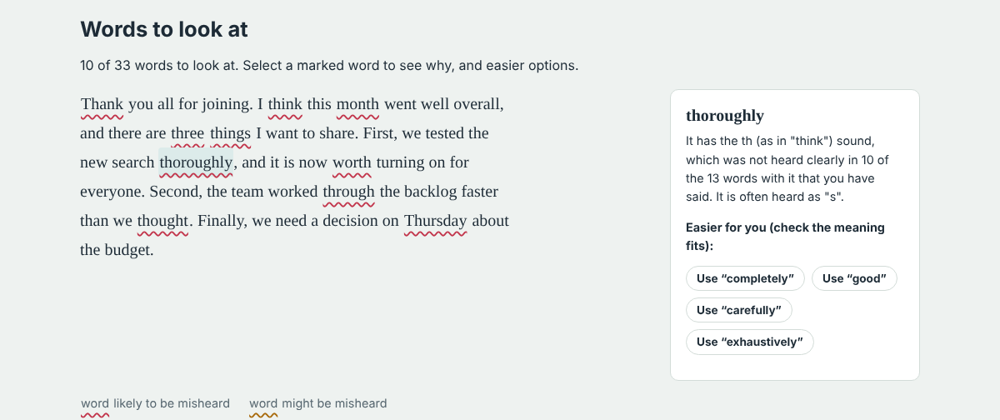
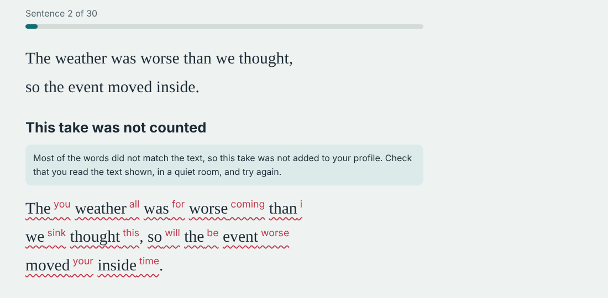

# Sayable

Sayable helps non-native English speakers get ready for presentations and interviews. It learns which
sounds speech recognition fails to hear when *you* speak, then checks your script for the words you are
most likely to be misheard on, and suggests easier words that mean the same thing.



## What it does

1. **Builds your profile.** You read 30 short sentences aloud. Each recording is transcribed with Whisper
   and compared word by word with what you meant to say.
2. **Checks a script.** Paste a talk or an interview answer. Words that contain sounds you struggle with are
   marked, each with a plain explanation ("It has the th sound, which was not heard clearly in 10 of the
   13 words with it that you have said. It is often heard as s.") and alternatives that are easier for you.
3. **Rehearses it.** Read the script part by part and see which words were heard and which were not. Every
   rehearsal also feeds the profile.



## How it works

**Listening honestly.** Whisper runs on your own computer through
[faster-whisper](https://github.com/SYSTRAN/faster-whisper). It is told the language but *not* the text you
were reading. With the text as a hint it would "hear" the right words even when they were unclear, which is
the very thing being measured. Whisper's per-word confidence is kept too: a word heard correctly but with
low confidence counts as *unclear*, which is weaker evidence than a misheard one.

**Comparing what was said with what was heard** (`core/speech/align.py`). Both texts are normalised the same
way (case, punctuation, digits, British and American spelling) and aligned with edit distance. Homophones are
not errors ("their" heard as "there" says nothing about pronunciation), and "everyone" heard as "every one"
counts as a match.

**Blaming the right sound** (`core/speech/profile.py`). When "think" is heard as "sink", the two
pronunciations from the [CMU Pronouncing Dictionary](https://github.com/cmusphinx/cmudict) are aligned too,
which shows that TH became S. Only TH is charged with the error, not the other sounds in the word. Each
sound's error rate is smoothed towards your overall average, so one bad word cannot make a sound look
hopeless. Short function words (the, of, a…) are left out: recognisers drop and add them freely.

**Scoring a word** (`core/speech/risk.py`). A word is heard correctly only if all of its sounds are, so its
risk is one minus the product of each sound's chance of being heard. If you have said the word itself
before, that history is blended in. A word is only flagged when there is a reason that can be shown to you.

**Suggesting alternatives** (`core/speech/suggest.py`). Synonyms come from WordNet (built into a small data
file by `scripts/build_word_data.py`), with endings put back ("thinking" → "believing") and checked against the
dictionary. Every option is scored against *your* profile, and only clearly easier ones are kept. Optionally,
Claude suggests options that fit the sentence; those are scored the same way.

**Not counting bad takes.** If most of a recording does not match the text (the wrong sentence was read, or
the room was noisy), the result is shown but not saved, so the profile is not taught that every sound is hard.

## Running it

### On a Mac

Double-click `start.command`. The first run creates a Python environment, installs the packages and
downloads the speech model (about 150 MB), so it takes a few minutes. Your browser then opens Sayable.
Keep the Terminal window open while you use it.

If macOS says the file cannot be opened, right-click it, choose **Open**, then **Open** again. You need
Python 3.10 or newer from [python.org](https://www.python.org/downloads/).

### Anywhere else

```bash
python3 -m venv .venv
source .venv/bin/activate          # Windows: .venv\Scripts\activate
pip install -r requirements.txt
python manage.py migrate
python manage.py prepare_speech    # downloads the speech model once
python manage.py runserver
```

Then open http://127.0.0.1:8000 and create an account.

### Settings

| Environment variable | Default | Purpose |
| --- | --- | --- |
| `SAYABLE_WHISPER_MODEL` | `base.en` | `small.en` is more accurate but slower |
| `ANTHROPIC_API_KEY` | | a server-wide key for Claude suggestions (users can also add their own) |
| `SAYABLE_CLAUDE_MODEL` | `claude-haiku-5-5` | the Claude model used for suggestions |
| `SAYABLE_DEBUG` | `1` | set to `0` when deploying |
| `SAYABLE_SECRET_KEY`, `SAYABLE_ALLOWED_HOSTS`, `SAYABLE_TRUSTED_ORIGINS` | | needed when deploying |

## Tests

```bash
python manage.py test core
```

The tests cover the text normalisation, alignment, profile, risk scoring and suggestions, every page and API
endpoint (with a fake recogniser in place of Whisper), and one check that real audio can be decoded. GitHub
Actions runs them on every push.

## Project layout

```
core/speech/        the analysis engine: plain Python, no Django
  text.py           normalising and splitting text
  align.py          what was said vs what was heard
  phonemes.py       pronunciations (CMU dictionary) and sound names
  profile.py        per-sound error rates for one speaker
  risk.py           how risky a word is, and why
  suggest.py        easier alternatives
  claude.py         optional suggestions from Claude
  recognise.py      Whisper
  sentences.py      the sentences read to build a profile
core/               the Django app: models, views, templates, static files
scripts/            rebuilds the synonym data file
```

## Privacy

Recordings are written to a temporary file, transcribed and deleted. Only the words are stored. With Claude
switched on, the word and its sentence (text only) are sent to Anthropic's API.

## Limitations

- Speech recognition stands in for a human listener, and it is not the same thing. A recogniser that fails on
  a word is a good warning sign, but people use context in ways it does not.
- Whisper's language model sometimes "corrects" a word that was not said clearly, so some problems are missed.
  Low-confidence words partly make up for this.
- The thesaurus does not know the sentence, so offline options need a check that the meaning fits.
- Recording in the browser needs HTTPS or `localhost`. Using it from a phone needs a deployed version.

## Credits

- Pronunciations: [CMU Pronouncing Dictionary](https://github.com/cmusphinx/cmudict), BSD licence
  (`core/speech/data/CMUDICT_LICENSE`).
- Synonyms: [WordNet](https://wordnet.princeton.edu), Princeton University, under the WordNet licence
  (`core/speech/data/WORDNET_LICENSE`).
  Word frequencies from [wordfreq](https://github.com/rspeer/wordfreq) (used only when building the data file).
- Speech recognition: [Whisper](https://github.com/openai/whisper) via
  [faster-whisper](https://github.com/SYSTRAN/faster-whisper), both MIT licensed.
